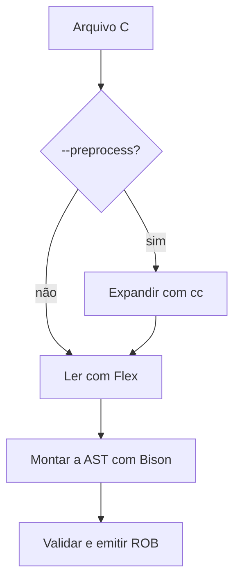

# C2ROB: o que mudou no piloto de pré-processamento e `noinline`

A base de comparação é a versão final de **especificadores de tipos e
posição dos qualificadores**, com 238 casos. O piloto acrescenta duas etapas
que `dummy.c` precisava: expandir suas macros antes de analisar o C e
transportar o atributo `noinline` da função até o ROB. Também reorganiza os
cabeçalhos do tradutor. Os quatro passos de validação da AST continuam
usando a mesma lógica da base.

## 1. O que impedia `dummy.c` de passar

No arquivo original da amostra há, entre outras, estas linhas:

```c
#define MAGIC 0xBE

int __attribute__ ((noinline))
benchmark(void)
{
    return MAGIC;
}

#undef MAGIC
```

Antes, o lexer ignorava linhas simples de `#define`. Ignorar a linha de
definição deixa o nome `MAGIC` no corpo da função, pois não o substitui.
O lexer também entregava `__attribute__` como identificador comum, e a
gramática não esperava a construção com dois pares de parênteses. Por isso
o primeiro diagnóstico de `dummy.c` apontava para o atributo. Corrigir
só o atributo deixaria as diretivas e a referência à macro por resolver.

Agora o tradutor produz:

```rob
int32 benchmark() noinline {
    return 190;
}
```

O pré-processador substitui `MAGIC` por `0xBE`; a lógica de literais e
tipos que já existia converte esse valor para `190` no ROB. A palavra
`noinline` depois dos parênteses é a forma que o Robcmp já aceita.
Ela pede que o compilador mantenha a função sem substituí-la pelo corpo
no ponto de chamada. Isso é útil em benchmarks: uma chamada pode delimitar
a função medida. O atributo não impede outras otimizações, como uma
chamada de cauda, nem garante a permanência de código morto.

## 2. Caminho da entrada até a AST



### `c2rob.l`: lexer e entrada pela linha de comando

O `main` agora reconhece `--preprocess`, além de `-f`, `-d` e
`--abi=ilp32|lp64`. Ele ainda exige exatamente um arquivo de entrada.
Sem a opção nova, abre esse arquivo com `fopen`, como antes.
Com a opção, abre o fluxo expandido por `cpreprocess::open` e o entrega
em `yyin`, que é a entrada lida pelo lexer. Os dois caminhos usam o
mesmo Flex, Bison e emissor.

Quando o driver C falha, o `main` retorna erro antes de chamar
`yyparse()`. As mensagens do driver ficam em `stderr` e o C2ROB
acrescenta o contexto `preprocess:`. Quando quem rejeita a entrada é
o analisador do C2ROB, a mensagem usa `arquivo.c (preprocessed):`.
Nesse caso as posições são do texto expandido, porque o piloto usa
`-P` para remover os marcadores de linha.

O lexer também passou a devolver `TOK_GNU_ATTRIBUTE` ao ler
`__attribute__`. Ele continua devolvendo as peças seguintes
separadamente: `(`, `(`, identificador, `)`, `)`.
Isso deixa o Bison verificar a estrutura, inclusive se houver espaços,
quebras de linha ou comentários entre as peças. O nome `noinline` não
virou palavra reservada nova no lexer de C. A exceção legada para a
grafia exata `__attribute__((used))` continua no lexer como já estava.

### `include/preprocess.h`: o processo externo

Este cabeçalho novo concentra a lógica de pré-processamento, sem depender
da AST. O comando executado equivale a:

```bash
cc -E -P -nostdinc -dI -x c -std=c11 arquivo.c
```

| Opção | Função |
|---|---|
| `-E` | Para após o pré-processamento: expande macros e resolve diretivas. |
| `-P` | Omite os marcadores de origem que o parser de C2ROB não reconhece. |
| `-nostdinc` | Desliga as pastas padrão de busca dos cabeçalhos do sistema. |
| `-dI` | Deixa as inclusões ativas visíveis na saída do pré-processador, para que o piloto possa rejeitá-las. |
| `-x c -std=c11` | Pede ao driver que trate a entrada como C, no modo C11. |

O driver padrão é `cc`. Pode-se indicar outro executável, por exemplo
`C2ROB_CC=gcc ./c2rob --preprocess arquivo.c`. `C2ROB_CC` contém o nome
ou caminho de **um executável**. O helper chama `posix_spawnp` com uma
lista de argumentos; não monta um comando de shell.

O `stdout` desse processo vai para um fluxo de `tmpfile()`. O C2ROB
espera o processo terminar com `waitpid`, verifica o código de saída e
rebobina o fluxo. `checkStandaloneInput` verifica as diretivas deixadas
por `-dI`, e o arquivo temporário volta ao começo para o Flex. Ele é
fechado e descartado ao terminar. O `stdout` do C2ROB fica reservado
para o ROB.

O piloto é para **fontes independentes**. Um `#include` ou `#import`
ativo pode causar falha no próprio driver; se o driver conseguir resolver
uma inclusão local, o tradutor rejeita a unidade antes do parser.
Uma inclusão no ramo inativo de `#if` não entra no resultado.
O teste de macros cobre esse caso. O modo direto conserva seu tratamento
legado de `#include` como `use` no ROB.

O pré-processamento não muda a ABI usada pelo tradutor. `--abi` ainda
seleciona o modelo dos tipos da entrada C, enquanto macros predefinidas
como `__SIZEOF_LONG__` vêm do driver escolhido. O piloto foi validado
com macros independentes da plataforma; para condicionais que consultem
o alvo, ainda é necessário definir e validar o ambiente do compilador
desse projeto. `ARCH` no Makefile é o alvo do **Robcmp**, não do
pré-processador.

## 3. Como o atributo percorre a gramática e chega ao LLVM

### `c2rob.y`: cabeçalho comum de função

A produção `function_attribute` reconhece um atributo GNU simples
e sem argumentos. Aceita `noinline` e a grafia GNU `__noinline__`.
Um nome simples diferente, como `cold`, tem diagnóstico em inglês.
Listas de atributos e atributos que recebem argumentos ficam fora do
recorte. Os formatos cobertos são:

```c
__attribute__((noinline)) int antes(int n) { return n; }
int __attribute__((__noinline__)) entre(int n) { return n; }
int depois(int n) __attribute__((noinline));
int depois(int n) { return n; }
```

A produção nova `function_header` reúne o tipo de retorno, o nome, a
lista de parâmetros e, quando presente, o atributo antes do tipo ou
entre o tipo e o nome. `makeFunctionHeader` cria o nó `Function`
com esses dados e registra se o especificador `static` estava presente.

`func_decl` é o caminho do **protótipo**: usa o cabeçalho sem corpo e
pode ler o atributo depois da lista de parâmetros, antes do `;`.
`func_impl` é o caminho da **definição**: usa o mesmo cabeçalho e chama
`setBody` com a lista de comandos entre chaves. Um corpo vazio ainda
é uma lista válida, diferente de um protótipo sem corpo. As formas
anteriores de lista de parâmetros e de cabeçalho com retorno por ponteiro
continuam passando pelas validações já existentes.

Na ação de `program`, `propagateNoInline` olha os nós de função de
nível global duas vezes. Na primeira, guarda os nomes marcados; na segunda,
aplica a marca aos outros nós dos mesmos nomes. Assim, o protótipo de
`depois` acima faz a definição também sair com o atributo. Se a função
marcada é `static`, o piloto informa erro: a ligação interna da função C
precisaria ser representada corretamente, e emitir uma função ROB com
ligação externa perderia essa propriedade.

Depois da propagação, a ordem continua sendo: resolver nomes e escopos,
validar comandos e condições, validar qualificadores, aplicar as conversões
de inteiros e emitir ROB. A gramática manteve os **dois conflitos
shift/reduce já existentes**.

### `include/nodes.h`: o atributo no nó `Function`

O nó ganhou `noInline`, inicializado como falso,
`markNoInline()` para marcar e `hasNoInline()` para consultar.
`setBody()` liga a lista de comandos ao nó quando a gramática reconhece
uma definição. O método `toStr()` monta tipo, nome, parâmetros e, se
marcado, acrescenta ` noinline` depois do `)`. Só então imprime o
`;` do protótipo ou o bloco da definição. Para funções sem a marca,
o texto é o mesmo da versão anterior.

O Robcmp já reconhecia essa posição do atributo. Sua geração de IR
associa `noinline` à função do LLVM. O teste confere o grupo de atributos
da **função específica**, pois encontrar a palavra em outro ponto do IR
não provaria que foi aplicada à função certa. Também verificamos que uma
chamada a `inc` continuou presente no IR otimizado com `-O2`.

## 4. Organização dos cabeçalhos

O `Makefile` da raiz acrescenta `-Iinclude` ao comando C++.
Assim, `#include "nodes.h"` continua válido mesmo com o arquivo na pasta
nova. `HEADERS` lista os `.h` escritos à mão para recompilar o binário
quando um deles muda. O Bison regenera `c2rob.tab.c` e
`c2rob.tab.h` quando a gramática muda; o Flex usa esse cabeçalho gerado
para saber os nomes dos tokens. O cabeçalho gerado continua na raiz como
artefato de build. Os arquivos `.l` e `.y` também continuam na raiz.

| Arquivo em `include/` | Responsabilidade | Mudança de conteúdo |
|---|---|---|
| `nodes.h` | Nós da árvore sintática e emissão ROB. | `Function`, mais a proteção `#pragma once`. |
| `source_type.h` | Especificadores, qualificadores, aliases e modelos ILP32/LP64. | Idêntico; só mudou de pasta. |
| `scope_support.h` | Resolução de nomes e sombreamento em escopos C. | Idêntico; só mudou de pasta. |
| `while_support.h` | Condições, validação de comandos, laços e retornos. | Idêntico; só mudou de pasta. |
| `qualifier_support.h` | Uso de `const`, `volatile` e `static` nos objetos analisados. | Idêntico; só mudou de pasta. |
| `integer_support.h` | Promoções, conversões e emissão correta de expressões inteiras. | Idêntico; só mudou de pasta. |
| `preprocess.h` | Invocação do driver, fluxo temporário e verificação da entrada expandida. | Novo. |

Os cinco arquivos que só mudaram de pasta foram comparados byte por byte.
O cabeçalho `test/unit/pilot_include_payload.h` é **entrada de teste C**,
por isso fica ao lado do caso que o inclui.

## 5. Execução da amostra e arquivos da entrega

`test/Makefile` veio do backup da amostra e foi adaptado. Ele consulta
`PREPROCESS_FILES` pelo nome do arquivo antes de montar o comando
C2ROB. O padrão é `dummy.c`; uma lista explícita pode ser fornecida pelo
usuário, ou esvaziada com `PREPROCESS_FILES=`. A regra seguinte compila
o `.rob` com Robcmp e a última usa `objdump -D` para desmontar o
objeto em `.s`. `OUT` seleciona a pasta da rodada. Use uma pasta
diferente para medir uma configuração diferente.

O binário C2ROB agora é dependência normal do alvo `.rob`, para que
recompilar o tradutor invalide as saídas antigas. `.SECONDARY` conserva
`.rob` e `.o` que deram certo. `.DELETE_ON_ERROR` remove saídas
de uma receita que falhou, incluindo arquivos vazios que uma
redireção `>` poderia ter aberto. O alvo `count` conta arquivos
`.s` presentes; ele não examina mensagens do Robcmp nem compara execução.

| Grupo | Mudou em relação à base de tipos |
|---|---|
| `c2rob.l`, `c2rob.y`, `Makefile` | Entrada, gramática e build descritos acima. |
| `include/` | Seis cabeçalhos movidos; só `nodes.h` editado entre eles. `preprocess.h` adicionado. |
| `test/unit/run_tests.py` | Aceita `preprocess: true` e verifica `ir_noinline` durante a integração. |
| `test/unit/cases.json` | Preserva as 238 entradas e acrescenta 10. |
| `test/unit/Makefile`, testes e referências anteriores, `LICENSE` | Conteúdo preservado. |
| `test/Makefile` e `test/cfiles/` | A regra da amostra foi atualizada; os 142 fontes da amostra foram incluídos sem alterar seu conteúdo. |
| Materiais antigos de `docs/` e auxiliares de testes | Reaproveitados do backup como histórico, sem mudanças de conteúdo. |
| Robcmp | Nenhuma alteração no compilador, na gramática ROB ou nas bibliotecas. |

O inventário [ARQUIVOS_COMPARADOS.txt](ARQUIVOS_COMPARADOS.txt) lista
os caminhos individualmente, incluindo todos os arquivos mantidos.
O ZIP traz os fontes, a amostra, os testes e a documentação. Os
arquivos gerados por Flex/Bison, o executável C2ROB e as pastas de
resultados do Makefile são gerados na sua máquina pelos comandos do
[README](../README.md).

## 6. O que cada teste novo prova

Os testes de entrada ficam em `test/unit/`; cada nome tem uma entrada
correspondente em `cases.json`.

| Caso | O que precisa acontecer |
|---|---|
| `pilot_dummy` | Traduz o fonte real com o piloto, expande `MAGIC`, mantém os quatro atributos no IR e compara `verify_benchmark` com C. |
| `pilot_preprocess_macros` | Expande macro com argumento e continuação de linha, respeita `#undef`/nova definição e ignora o ramo inativo de `#if`. Uma macro também fornece o próprio atributo. |
| `pilot_noinline_definition` | Lê o atributo antes do tipo e entre tipo e nome, com espaços, comentário e grafia `__noinline__`, no caminho direto. |
| `pilot_noinline_prototype` | O atributo depois dos parâmetros do protótipo também aparece na definição e no LLVM IR. |
| `pilot_noinline_wrong_target` | Um atributo de função numa variável resulta em erro controlado. |
| `pilot_noinline_unknown_attribute` | `cold` é rejeitado explicitamente. |
| `pilot_noinline_static_linkage` | A marca vinda de um protótipo `static` não faz o C2ROB emitir uma função pública. |
| `pilot_preprocess_error` | Um `#error` do driver encerra a tradução sem ROB. |
| `pilot_preprocess_include` | Uma inclusão local ativa via macro é recusada, mesmo quando o driver encontra o cabeçalho. |
| `pilot_preprocess_label` | Um erro sintático depois da expansão indica que a posição é no texto pré-processado. |

Com `preprocess: true`, o executor passa a opção **só** para aquele
caso. Em integração, a comparação usa o C original como referência.
Os casos negativos exigem erro com diagnóstico e `stdout` sem ROB.
O campo `ir_noinline` lista as funções cujos atributos de LLVM devem
ser verificados. Nos casos que precisam de `main` para executar em
host, a suíte continua usando uma cópia `.validation.rob` separada;
o ROB da tradução fica intacto. A receita real de `dummy.s` usa o
`-bdep` do Robcmp e aceita o arquivo de biblioteca sem inventar um
`main` no `dummy.rob`.

## 7. Resultados verificados

| Verificação | Resultado |
|---|---|
| `make test` | **248 passaram, 0 falharam**. |
| `make test-integration` | **248 passaram, 0 falharam**; 154 objetos STM32F1 e 154 IRs aceitos por `opt`. |
| C original versus ROB no host | **153** execuções comparadas; um caso anterior só de protótipo continua sem execução. |
| Entradas esperadas como inválidas | **94** diagnósticos controlados na suíte. |
| Saídas antigas | Os **150 ROBs positivos** da suíte anterior foram idênticos byte por byte. |
| Amostra inteira | De 142 entradas, a tradução passou em 3. Destas, `teste.c` e `dummy.c` completaram o caminho sem erro reportado; `board.c` ainda informa falta de `boardsupport.rob`. |
| `dummy.c` sozinho | Gerou `.rob`, `.o` ARM e `.s` no primeiro comando. `benchmark()` retornou 190, e `verify_benchmark(188…192)` retornou 0, 0, 1, 0, 0, iguais ao C. |

A validação usou GCC/G++ 13.3, Bison 3.8.2, Flex 2.6.4 e LLVM
19.1.7. Foram comparados 127 arquivos de código do Robcmp e 33 arquivos
de biblioteca com o ZIP fornecido, todos idênticos. A comparação de
execução foi feita no host; os objetos ARM foram gerados e inspecionados,
sem execução em placa. O piloto desativado conservou os códigos de saída
da tradução direta para as 142 entradas.

## 8. O limite desta versão

Este incremento cobre o pré-processamento optativo de fontes sem
dependências de cabeçalhos e o atributo GNU simples em funções com
assinaturas já aceitas. Não há configuração geral de `-I`, `-D`,
cabeçalhos de cada projeto, pragmas de benchmark ou novos atributos.
`inline` e a exceção legada de `used` continuam com o tratamento
anterior; combinações de atributos não foram validadas pelo piloto.
As limitações anteriores da linguagem de entrada, incluindo laços
`for` mais gerais, ponteiros e matrizes, continuam separadas. A amostra
também conserva a falha anterior de `libpicojpeg.c` por sinal;
ela não aparece como sucesso nos números acima.
